[English](README.en.md) | [Español](README.md)

# Matemáticas Teacher

A desktop app (Tauri v2 + React/TypeScript) that teaches kids to solve math problems step by step on an animated chalkboard, with a balance scale, pizzas, and a chat to ask questions about each step. The AI runs **inside the app**, with no internet and no servers: models are downloaded once and used on the own computer.

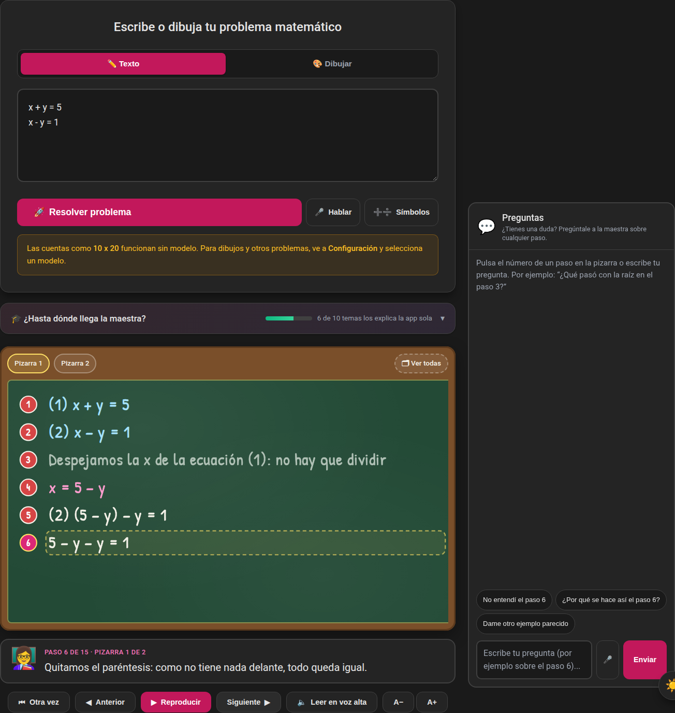

## Features

- **Animated chalkboard** with step-by-step explanations and numbered steps.
- **Own symbolic solver** (no model needed): arithmetic, order of operations, roots of any index, fractions, first-degree equations, equations with two letters, and systems of two equations — in `src/lib/board/`.
- **"How far can the teacher go?" panel**: shows which topics the app explains on its own, which go to the model, and what comes next.
- **One board at a time**: long solutions are split across several boards and you see one at a time (or all together, if you ask).
- **Visuals**: balance scale for equations, pizzas and rectangles for fractions.
- **Question chat** about each step (`StepChat`).
- **Microphone**: ask your questions out loud; Whisper transcribes the audio on the device, with no internet. The speech model is downloaded from Settings › Microphone.
- **Voice and symbols inside the problem box**: **Speak** dictates the problem into the text box and **Symbols** opens a keypad of math symbols (`+ − × ÷ = / ( ) √ ² ³ ^ x y .`) for anyone who does not know how to type them. Both are accessible (spoken names, visible focus, Escape closes).
- **The input steps aside when there is a board**: the problem box shrinks to a bar with the problem and **New problem**, and the topics panel moves below the board.
- **Built for phones**: on narrow screens the chat is a collapsible sheet fixed at the bottom (it opens when you tap a step number, Escape closes it) and nothing overflows the screen.
- **No model? The app says so**: anything that needs AI shows a **Pick a model** button that opens Settings, and the **Solve** button says why it is disabled.
- **Settings with an index** (*Models · Voice · Interface · Advanced*), a fixed header and a close button.
- **Lucide icons** (`lucide-react`) instead of emojis; only the teacher and child characters and the 🎉 celebration are kept.
- **Sums said in words** (Spanish): "divide trescientos entre cincuenta" or "multiplica 12 por 3" are solved on the board with the full procedure.
- **Examples from the chat**: when you ask something, the teacher asks whether you want the answer here or worked out on the board; if you pick the board you can **erase and write** or put it on **another board** without losing the main one.
- **Practice by dictating operations**: on a first-degree equation, practice mode lets the child dictate operations ("add 3", "divide by 4") and the board runs them step by step on the balance scale; if it is not understood, the teacher asks instead of acting.
- **Drawing canvas**: reads what the child writes/draws using vision models (mtmd) and lets them correct it.
- **Local AI with llama.cpp** embedded in the app (like Handy with whisper): no server, no ports; CPU/CUDA/Vulkan backends are loaded at runtime depending on the hardware.
- **Model manager** (Llama, Qwen, Phi, Gemma, Mistral): download from HuggingFace, select the active model, and delete.
- **Installers**: AppImage (NVIDIA GPU and CPU-only builds) and `.dmg` for macOS (Apple Silicon, Metal GPU) in `instaladores/`. The app updates from within (planned; see [docs/auto-update.md](docs/auto-update.md)).

## What it can explain

The app solves **on its own** (no model, always correct, no skipped steps) up to **systems of two first-degree
equations**. Anything beyond that is explained by the local model, and the steps are worth checking. The same list
is shown inside the app in the *¿Hasta dónde llega la maestra?* panel (`src/lib/capabilities.ts`); when a new topic
is added, both places are updated.

| # | Topic | Examples | How it explains it | Solved by |
|---|---|---|---|---|
| 1 | Arithmetic | `47 + 38`, `156 entre 12`, `34 x 444` | Column method, with carrying and borrowing | ✔ The app |
| 2 | Order of operations | `3 + 4 × 2`, `(8 − 3)²`, `√50` | Step by step; non-exact roots by trial | ✔ The app |
| 3 | Fractions | `1/2 + 1/4`, `2/3 × 3/5`, `6/8` | With pizzas | ✔ The app |
| 4 | Equations with one letter | `2x + 4 = 10`, `2(x + 3) = 14` | With a balance scale, then checks the answer | ✔ The app |
| 5 | One equation with two letters | `2x + 3y = 6` | Solves for y and finds pairs, explaining why each number is chosen | ✔ The app |
| 6 | Systems of two equations | `x + y = 5` and `x − y = 1` (one per line) | Substitution when a letter stands alone; otherwise elimination | ✔ The app |
| 7 | Quadratic equations | `x² = 9`, `x² + 5x + 6 = 0` | — | 🤖 Model |
| 8 | Inequalities, letter in the denominator | `2x + 1 < 7`, `6/x = 2` | — | 🤖 Model |
| 9 | Word problems | "Ana tiene 3 dulces…" | — | 🤖 Model |

Systems are written with one equation per line (`;` or `, ` also work).

Sums are also understood **said in words** (in Spanish): `divide 300 entre 50`, `multiplica doce por tres`,
`suma cuatro y cinco`, `resta 5 de 9` or `divide trescientos entre cincuenta` (number words up to millions). They are
solved with the same column procedure, not just the result (`parseArithmetic` and `wordsToDigits` in
`src/lib/board/parse.ts`).

## Screenshots

| | |
|---|---|
| 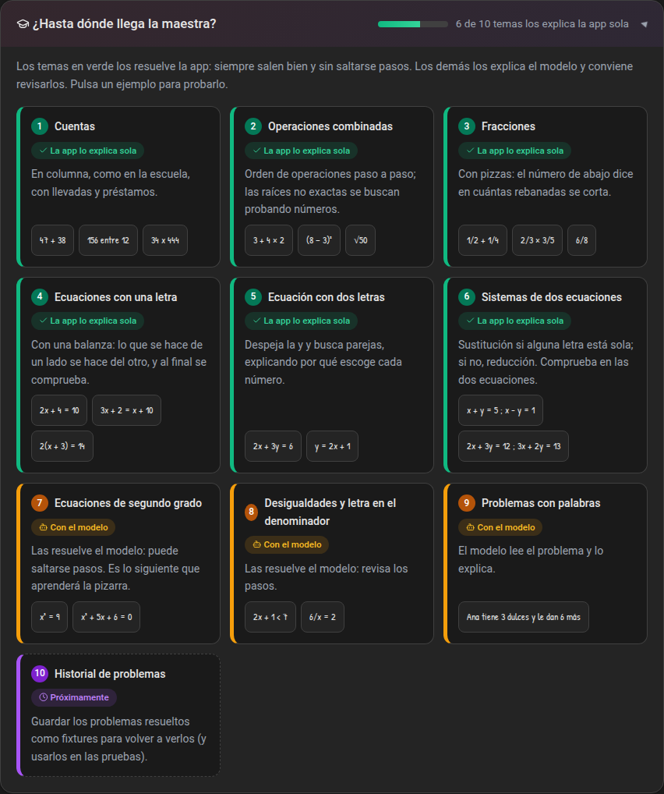 | 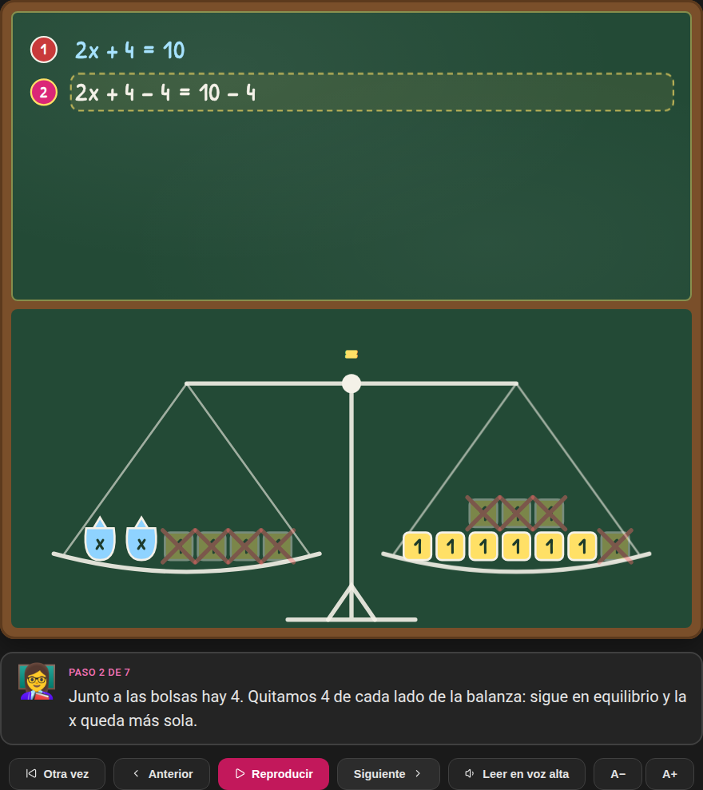 |
| **How far can the teacher go?** Clicking an example types it into the box. | **One-letter equation**: the scale shows what is removed from each side. |
| 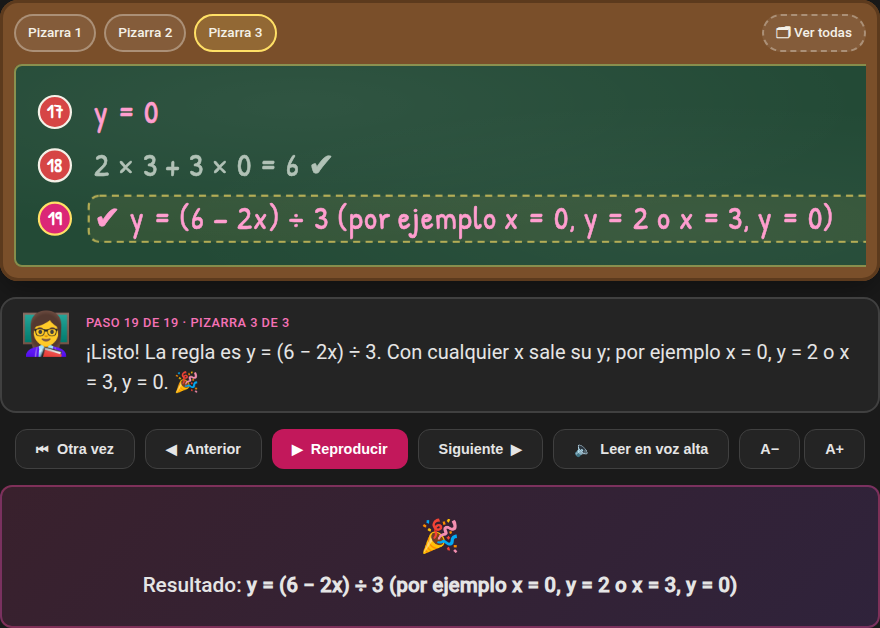 | 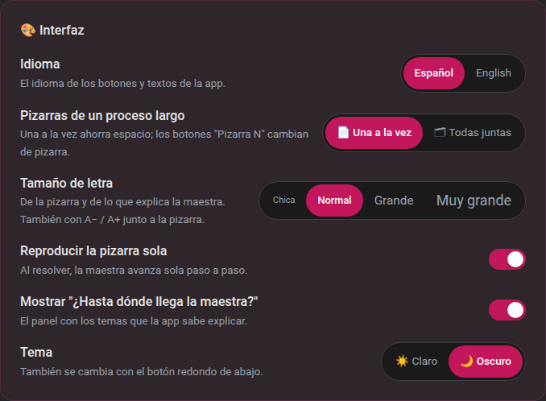 |
| **One board at a time**: the *Pizarra N* buttons switch boards and *Ver todas* shows them together. | **Settings › Interface**: boards, autoplay, topics panel, and theme. |
| 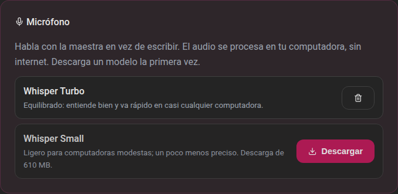 | 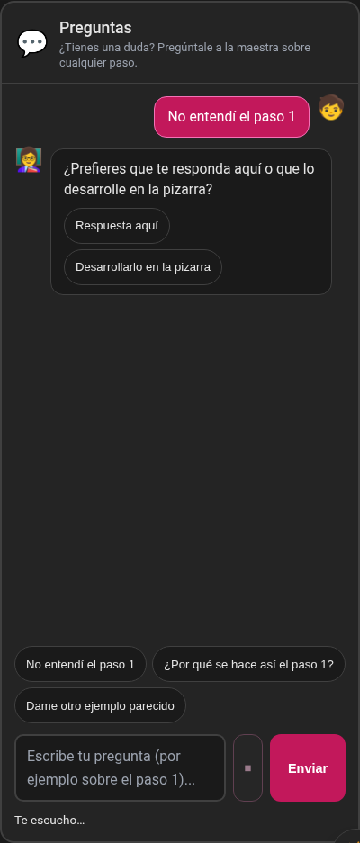 |
| **Settings › Microphone**: download the speech model once; audio never leaves the device. | **Talking in the chat**: press the microphone, speak, and the dictation is sent as your question. |
| 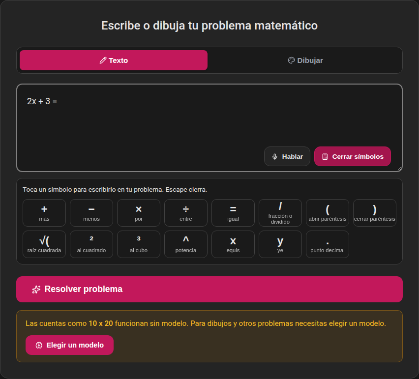 | 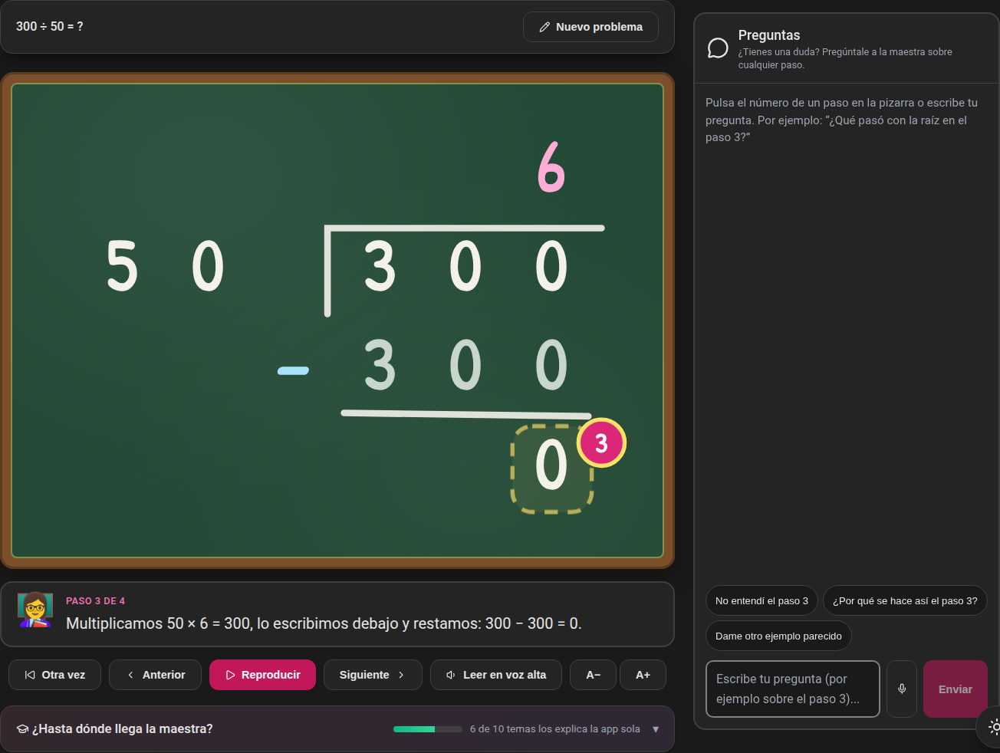 |
| **Symbols and voice inside the problem box**: every key has a spoken name and Escape closes the panel. | **"divide trescientos entre cincuenta"** is solved in the long-division house, step by step. |
| 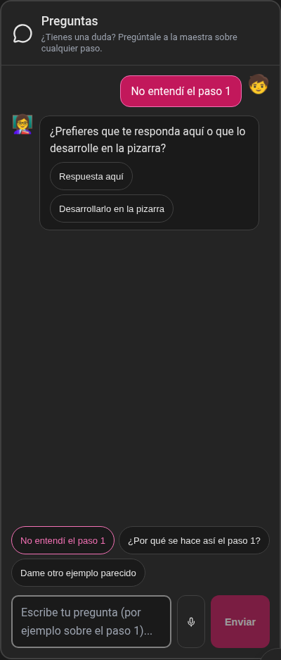 | 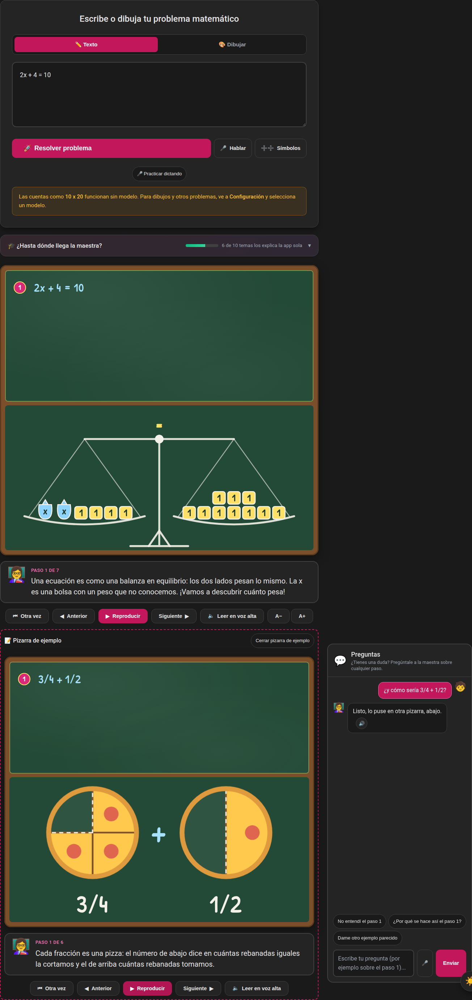 |
| **Before answering**, the teacher asks whether you want the answer here or worked out on the board. | **Another board**: the example is solved below without touching the main board. |
| 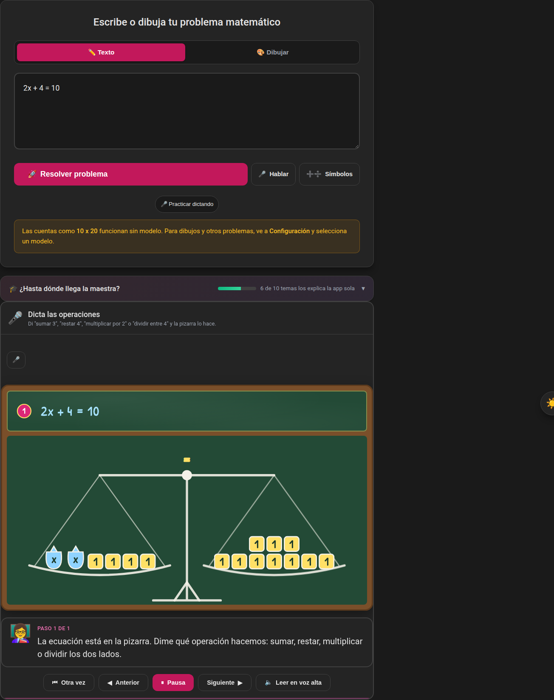 | 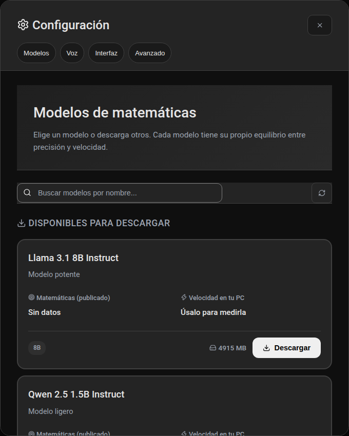 |
| **Practice by dictating**: say "add 3" or "divide by 4" and the scale does it on both sides. | **Settings with an index**: *Models · Voice · Interface · Advanced* jump to each section and the close button stays in place. |
| 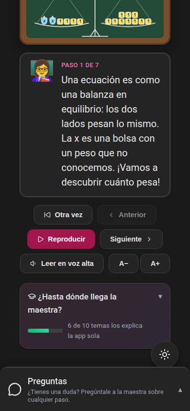 | 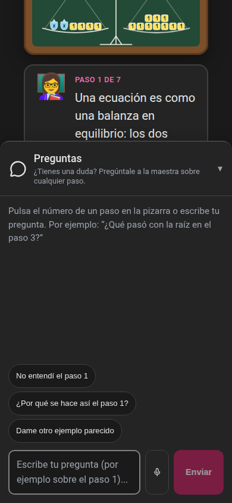 |
| **On a phone** the board stays in view and the chat is a collapsible bar at the bottom. | **Chat open**: it slides over the board and closes with Escape or by tapping the bar. |

Screenshots are generated with `npm run capturas` (Playwright with the e2e mocked backend) and saved to
`docs/capturas/`.

## Microphone

1. In **Settings › Microphone**, download a speech model (Whisper Turbo or Small) the first time.
2. Press the **microphone** button and speak; when silence is detected, the audio is transcribed. There are two microphone buttons:
   - **Inside the problem box** (**Speak**): what you say is typed into the problem box, so you can check it
     before solving.
   - **In a step's chat**: what you say is sent as a question.
3. Everything runs on the computer, with no internet. The microphone belongs to whoever turned it on: what is dictated
   into the problem box does not also reach the chat (and vice versa).
4. In **Practice by dictating** mode (first-degree equations) what you say are operations: "add 3", "subtract 4",
   "multiply by 2" or "divide by 4".

## Math symbols

The **Symbols** button inside the problem box (bottom right) opens a keypad with `+ − × ÷ = / ( ) √( ² ³ ^ x y .` for anyone who
does not know how to type them. Each key writes the symbol at the cursor and has a spoken name ("square root",
"squared") for screen readers; **Escape** closes it and returns focus to the button (`src/components/MathKeypad.tsx`).

## Questions in the chat

When you ask something (typed, dictated or with the quick buttons), the teacher first asks how you want it:

1. **Answer here**: the model replies in the chat.
2. **Work it out on the board**: an example is solved with the app's board. The problem comes from your question
   ("and how would 3/4 + 1/2 be?") or from the conversation if you ask for it "on the board"; if there is none, the
   model proposes one with the tag `[[PIZARRA: problem]]`, which the child never sees. It is only offered if the app
   can solve it and it is not the one already on the board.
3. Then the teacher asks where to put it: **Erase and write here** (the main board becomes the example and the chat
   resets), **Put it on another board** (an *Example board* appears below, with a close button, and the main one stays
   as it was) or **Just answer me**.

The logic lives in `src/lib/board/example.ts` (finding the example and the tag), `StepChat.tsx` (the questions) and
`MainApp.tsx` (the extra board). Rule 7 of the chat prompt (`CHAT_PROMPT` in `src-tauri/src/ai/engine.rs`) tells the
model when to use the tag.

## Interface settings

**Settings** opens as a dialog with a fixed header and an index (*Models · Voice · Interface · Advanced*) that jumps to each section; **Models** comes first because it is what you need to get started. It closes with the ✕ or with Escape.

In **Settings › Interface** (saved on the computer):

- **Boards for long solutions**: *Una a la vez* (one at a time, the default, saves space) or *Todas juntas* (all
  together). On the board, the *Ver todas* / *Una a la vez* button changes it just for that problem.
- **Font size** of the board and the explanation: small, normal, large, or extra large. It can also be changed with
  the **A−** / **A+** buttons next to the board. Text no longer shrinks when a line is long: if it doesn't fit, the
  board scrolls sideways.
- **Autoplay the board** when solving.
- **Show "¿Hasta dónde llega la maestra?"** on the main screen.
- **Language**: Spanish or English. Until you choose, the app uses your system language; switch it with the **ES / EN**
  button in the header or in Settings › Interface. Today the interface is translated; the board narration and the
  model's answers are still in Spanish.
- **Light or dark theme** (the system one until you choose).
- **App log** (Settings › App log): what the app is doing and its errors, with a filter and copy/clear buttons. It is
  also saved to `logs/app.log` in the app data folder, in case the app does not open.
- **Teacher voice** (offline): in Settings, download a natural voice — Piper (~64 MB, fast) or Kokoro (~334 MB,
  more expressive, female and male voices) — in Spanish or English (following the app language), or use the system voice (`espeak-ng`; the app detects your distro
  and tells you what to install if it is missing). The teacher reads math as words
  ("2x + 3y = 6" → "dos equis más tres ye igual a seis") and the board advances when each audio clip ends. The **Read aloud**
  button next to the board turns reading on.

## Coming soon

- **Quadratic equations** on the board (first `x² = 9`, then factoring and the quadratic formula).
- **Problem history saved as fixtures**: each solved problem will be saved as a file (the text and the board
  script) to view it again later without solving it again. The same files will be used as fixtures in the tests,
  to check that an explanation does not change by accident.

## Requirements

| | Minimum | Recommended |
|---|---|---|
| OS | Linux x86_64 (tested on Ubuntu 24.04) | — |
| RAM | 8 GB | 16 GB or more |
| Disk | 5 GB free (app + one small model) | 20 GB (several models) |
| GPU | Not required: works on CPU | NVIDIA with 8 GB VRAM or more |

Without a GPU it works the same, just slower (~15 s per explanation with a 2–3B model). With an NVIDIA GPU it is auto-detected at startup.

## Installation

### From the installer (the quickest way)

Download the installer (AppImage) from the *Releases* page or from [`instaladores/`](instaladores/):

| Version | Works on | Uses GPU | Size (AppImage / .dmg) |
|---|---|---|---|
| **con-GPU-NVIDIA** | Any PC | Yes, if an NVIDIA card with driver is present | ~520 MB / ~590 MB |
| **solo-CPU** | Any PC | Never | ~20 MB / ~100 MB |

```bash
# Any Linux (no install needed)
chmod +x matematicas-teacher_0.1.0_amd64_con-GPU-NVIDIA.AppImage
./matematicas-teacher_0.1.0_amd64_con-GPU-NVIDIA.AppImage
```

- The GPU version also works on PCs without a GPU: if no NVIDIA card is detected, it falls back to CPU.
- The AppImage runs directly, with nothing to install.
- Neither version ships models: they are downloaded from within the app.

### In-app update (planned)

The app does not auto-update yet. The plan is in [docs/auto-update.md](docs/auto-update.md): use
`tauri-plugin-updater` (the same mechanism as Handy) to check for a new version, download it,
install it and restart with the new version. It requires a minisign signature and a `latest.json`
manifest generated in CI.

### Build from source

1. **System packages** (Ubuntu / Debian):

   ```bash
   sudo apt update
   sudo apt install -y build-essential curl wget file pkg-config cmake clang libclang-dev \
     libwebkit2gtk-4.1-dev libssl-dev libxdo-dev libayatana-appindicator3-dev librsvg2-dev libasound2-dev \
     patchelf libfuse2t64
   ```

2. **Rust** (rustup) and **Node.js 20 or newer**.

3. **CUDA** (optional, NVIDIA GPUs only): the app builds with CUDA support by default, which
   requires the CUDA Toolkit. Without a GPU, build without CUDA:
   `npm run tauri -- build -- --no-default-features --features custom-protocol`.

4. **Clone and run**:

   ```bash
   git clone <repo-url> matematicas_teacher
   cd matematicas_teacher
   npm install
   npm run tauri dev
   ```

   The first build takes a while (it compiles llama.cpp and, with CUDA, its kernels: 10–30 min;
   without CUDA, a few minutes). Subsequent builds take seconds.

### First use

1. Open **Settings** and download a model from the list (all of them read drawings).
2. Click **Select**: it becomes the *Active Model* and is loaded into memory.
3. Type or draw a problem on the chalkboard.

### Where data is stored

| What | Where |
|---|---|
| Downloaded models | `~/.local/share/com.matematicas.teacher/models/` |
| Settings | `~/.local/share/com.matematicas.teacher/settings.json` |

The app also finds models already downloaded in the HuggingFace cache (`~/.cache/huggingface/hub`).

Full guide (requirements, common issues, GitHub Actions): [docs/INSTALACION.md](docs/INSTALACION.md) (Spanish).

## Development

```bash
npm install
npm run tauri:dev     # full app (frontend + Rust backend)
npm run dev           # frontend only (Vite, http://localhost:5173)
```

## Scripts

| Command | Description |
|---|---|
| `npm run dev` | Frontend with Vite |
| `npm run build` | `tsc` + `vite build` |
| `npm run test` | Unit tests (Vitest) |
| `npm run test:run` | Unit tests once |
| `npm run capturas` | UI screenshots for the README (`docs/capturas/`) |
| `npm run icono` | Generates every icon (PNG, .ico, .icns, and favicon) from `src-tauri/icons/icon.svg` |
| `npm run test:e2e` | E2E tests (Playwright) |
| `npm run tauri:dev` | Tauri app in dev mode |
| `npm run tauri:build` | Build the app |
| `npm run package:gpu` | Generate installers (AppImage) with GPU backends |
| `npm run package:cpu` | Generate CPU-only installers |

## Structure

```
src/                  React frontend (Vite + TypeScript)
  lib/board/          Symbolic solver: rational, fractions, equations, two letters, systems, expressions;
                      parse (sums and number words), example (chat examples), ops/intent (practice by dictating)
  lib/mic.ts          Microphone events and commands; useMic.ts dictates into a text box
  lib/capabilities.ts Topics the app explains ("¿Hasta dónde llega la maestra?" panel)
  lib/uiPrefs.ts      Interface preferences
  lib/contrast.test.ts WCAG contrast of the palette (light, dark and board)
  components/         Chalkboard, BoardVisual, LevelsPanel, UiPrefsSection, DrawingCanvas, StepChat, PracticeBoard,
                      MathKeypad, ModelBrowser, Ico (Lucide icons)
  pages/              MainApp, Settings
src-tauri/            Rust backend (Tauri v2)
  src/ai/             AI engine (llama.cpp, mtmd vision)
  src/models/         ModelManager: download/select/delete from HuggingFace
scripts/              GPU/CPU library staging and bundling; capturas/ generates the screenshots
e2e/                  Playwright tests
docs/INSTALACION.md   Installation and build guide (Spanish)
docs/auto-update.md   In-app update plan (Spanish)
docs/capturas/        UI screenshots
BITACORA.md           Project log (Spanish)
```

## License

LGPL-2.1 — see [LICENSE](LICENSE).

## Accessibility and security

- **Accessibility (WCAG 2.2 AA)**: usable with keyboard and screen reader (skip link, dialog with focus trap and Esc,
  named buttons, announced states), WCAG AA colour contrast (text 4.5:1; field borders, focus and icons 3:1) in the light theme, the dark theme and the board, visible focus, 40 px touch targets, and it
  honours *reduce motion*. `src/lib/contrast.test.ts` pins those ratios by reading the colours from `index.css`; `npx playwright test e2e/a11y.spec.ts` audits the UI with axe-core in light, dark and English.
- **Security**: the web view has a strict CSP and only the permission to listen to events (no file, dialog or link
  access); the backend caps the size of what it receives; voices are downloaded over HTTPS and verified against a
  SHA-256 before being installed.
